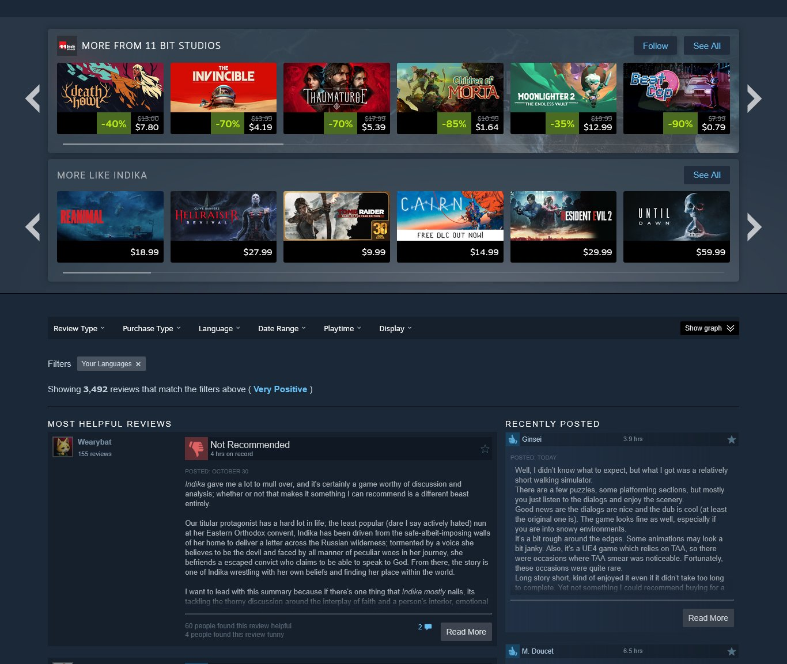
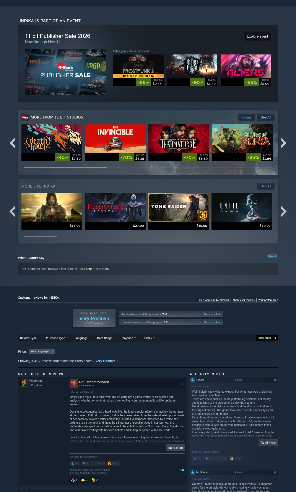
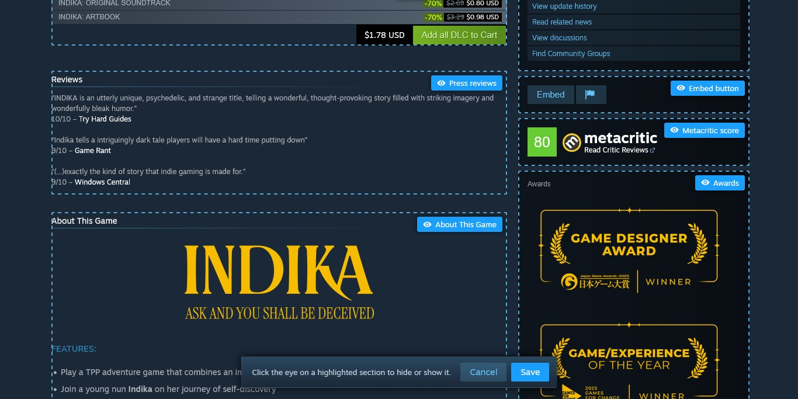
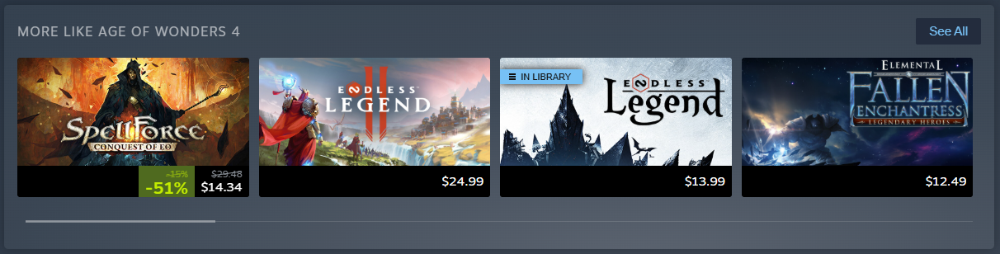
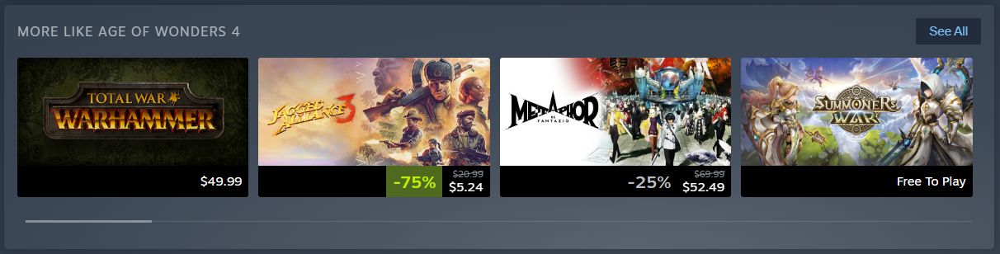
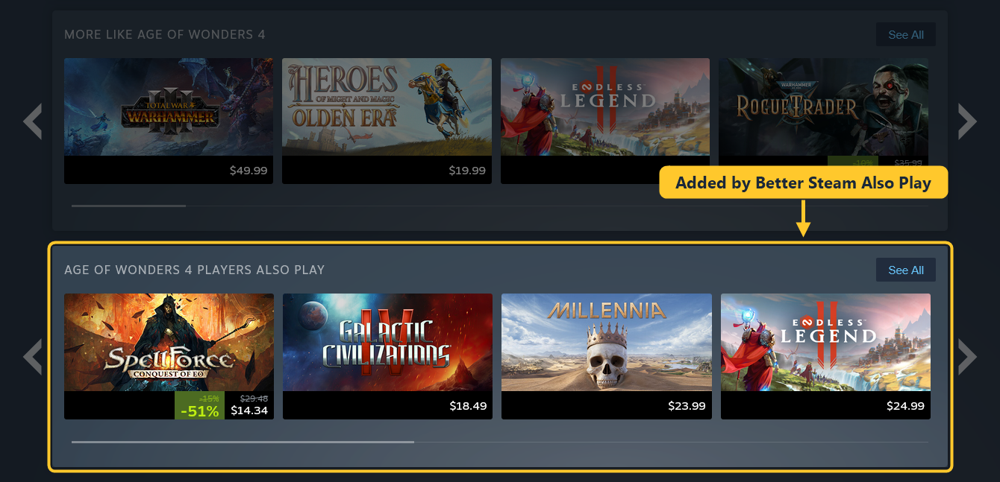

# Better Steam Store

Browser extensions that make Steam store pages cleaner and their recommendations better. Install Better Steam Store
to get everything, or only the parts you want as standalone extensions. They work in Chrome, Edge, Brave, Opera and
other Chromium browsers, and in Firefox.

## Hide anything you don't need on a Steam page

Store pages have grown a lot of boxes: sale events, curator blocks, award banners, review summaries, and vote buttons
and reactions under every review. Every one of them can be turned off, and the rows you keep can be made compact.

✅ This

❌ instead of this

Click "Edit on page" and every section that can be hidden is outlined right on the page. Click its eye to hide it,
then Save. There are about 40 options, from the wishlist bar at the top to the links under the reviews, and each one
is a switch you can turn back on.

It only hides and resizes what Steam already draws, so it works alongside other Steam extensions like Augmented Steam
and SteamDB.

More: [Better Steam Clean Interface](extensions/clean-interface)

## Better recommendations

Steam's "More like this" row often suggests games that only share a tag or two, and shuffles them on every visit.
Better Steam Store puts the "Games like" list from [SimilarGames.To](https://similargames.to), which depends on user
feedback, into that row instead. Steam still draws it, so prices, discounts, the wishlist button and "In library"
all work as before.

✅ This

❌ instead of this

A "Similar?" bar in each card's hover popup lets you vote on the picks, and the votes help clean up the lists.

A second row under it shows what the same players also play:

More: [Better Steam Recommendations](extensions/recommendations) and [Better Steam Also Play](extensions/also-play)

## The extensions

| Extension | What it does |
|---|---|
| [Better Steam Store](extensions/store) | All of the extensions below in one. |
| [Better Steam Clean Interface](extensions/clean-interface) | Hide and compact any part of a store page. |
| [Better Steam Recommendations](extensions/recommendations) | Better games in the "More like this" row, with votes. |
| [Better Steam Also Play](extensions/also-play) | A "players also play" row under "More like this". |

## Install

Each extension's page explains how to load it. The three standalone extensions can be loaded straight from their
folders. Better Steam Store is built from them, so use the zip from the
[latest release](https://github.com/similargamesto/better-steam-store/releases) or build it yourself (see below).

## Contributing

- `extensions/recommendations`, `extensions/also-play` and `extensions/clean-interface` are complete extensions. Make
  changes there and load the folder in your browser to try them.
- `extensions/store` only has Better Steam Store's own manifest, background loader, icons and README. The rest is
  copied in from the other three folders when it's built, so a fix in a standalone extension reaches it too.
- `python scripts/build.py` builds all four extensions into `dist/` and zips them, and checks that every file a
  manifest points to exists. GitHub Actions runs it on every push and pull request and attaches the zips to releases.
- Each part marks the page when it runs (`data-bsr-owner`, `data-bsa-owner`, `data-bsci-owner`) and does nothing if
  the mark is already there, so a standalone extension and Better Steam Store can be installed together. Background
  scripts are wrapped in their own scope because Better Steam Store loads them together.
- Steam's class names change on every update. Hide and compact rules only use stable hooks: IDs, `data-featuretarget`
  names, the carousel library's own classes and the order of elements. Please keep it that way.

## License

[MIT](LICENSE)
