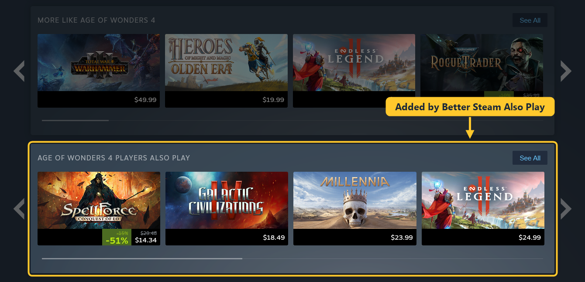

# Better Steam Also Play

Steam shows you games that look like the one you're on, but not what its players actually play next. This extension
adds that row to Steam store pages, right under "More like this": "Age of Wonders 4 players also play", with the list
from [SimilarGames.To](https://similargames.to).

Steam draws the row itself, so it looks and works like every other row on the page. Prices, discounts, the wishlist
button, the "In library" tag and the hover popup are all there.

## Features

- Shows up to 20 games, in the same order as on SimilarGames.To.
- Leaves out games from the same developer (Steam already shows them in the "More from" row), unreleased games and
  delisted games.
- "See All" opens the full list on SimilarGames.To.
- If a game isn't on SimilarGames.To, or its list doesn't arrive in time, nothing is added and the page stays as it is.
- Works side by side with [Better Steam Recommendations](../recommendations).

## Part of Better Steam Store

This extension is also included in [Better Steam Store](../store), which has all of our Steam
extensions in one.

## Privacy

The extension only connects to similargames.to and only sends the Steam app ID of the game page you open. There's no
account and no tracking, and nothing else is read from Steam.

## Install

Download or clone the [Better Steam Store repository](../..) first.

Chrome, Edge, Brave, Opera and other Chromium browsers:

1. Open `chrome://extensions` (`edge://extensions` in Edge) and turn on Developer mode.
2. Click "Load unpacked" and select the `extensions/also-play` folder.

Firefox (140 or newer):

1. Open `about:debugging#/runtime/this-firefox`.
2. Click "Load Temporary Add-on" and select `manifest.json` in `extensions/also-play`.

Firefox removes temporary add-ons when it restarts.

Thanks for reading. Contributions are welcome.
