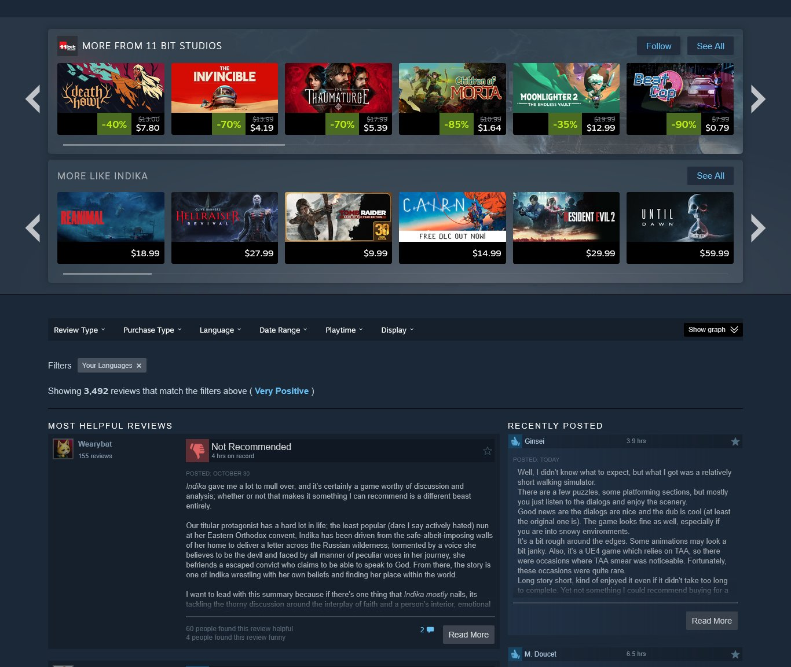
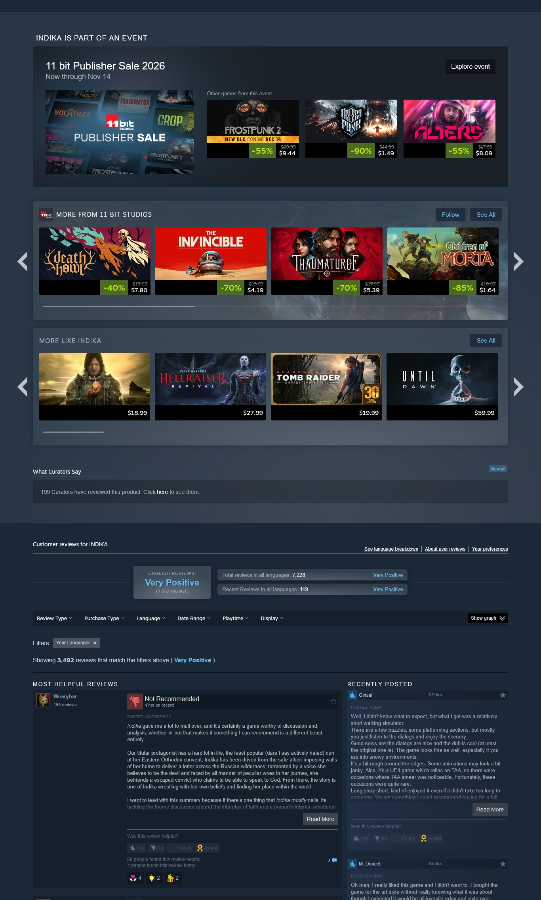
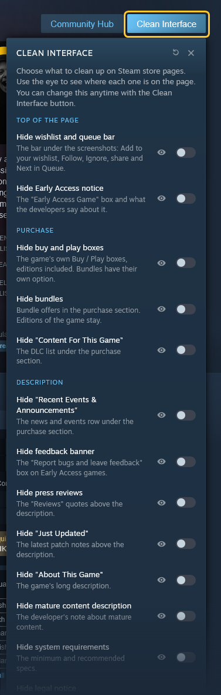
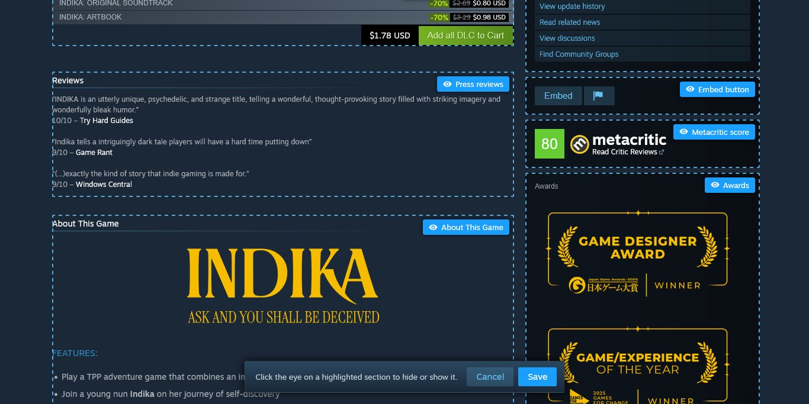
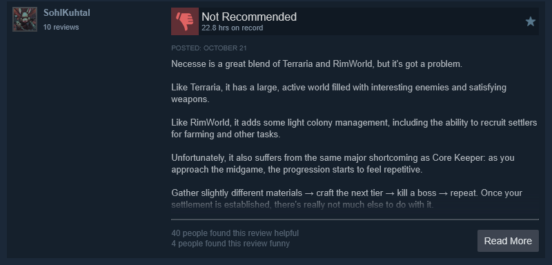
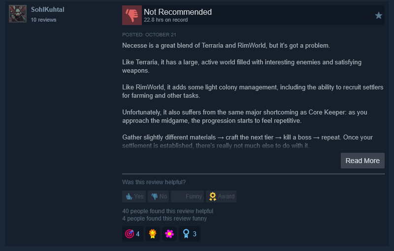

# Better Steam Clean Interface

Steam store pages keep growing: sale event boxes, curator blocks, award banners, review summaries, and vote buttons
and reactions under every review. This extension lets you hide the parts you don't need and makes the rows you keep
smaller. It only changes what Steam already draws, so the page still looks like Steam.

✅ This

❌ instead of this

Same part of the same page, with the default settings.

## Every change is a switch

People find different parts of the page useful, so nothing is forced. Open the panel with the "Clean Interface"
button next to "Community Hub" on any store page. Changes apply right away, without reloading.

The eye next to each switch scrolls to that part of the page and highlights it, so you can see what it changes
before turning it on. The arrow next to the close button puts everything back to the defaults.

## Edit on page

"Edit on page" outlines every section that can be hidden, right on the page. Click the eye on a section to mark it
hidden or visible, then Save. Cancel or Esc leaves everything as it was.

When you install the extension, a Steam store page opens with a short tour that has you open the Clean Interface
button, click Edit on page and hide a section. You can skip it at any step.

## Compact rows and reviews

Compact switches make sections smaller instead of removing them. "More like this", "More from" and "Players also
play" show six smaller cards in a row instead of four, with less empty space around them. Compact reviews drops the
vote buttons, award reactions and reviewer PC specs from each review and moves "Read More" under the line. The number
of reviews Steam shows stays the same.

| ✅ This | ❌ instead of this |
|---|---|
|  |  |

## All options

Grouped the same way as in the panel. Options marked (on) are turned on when you install the extension; the rest
start off.

### Top of the page

- Hide wishlist and queue bar: The bar under the screenshots: Add to your wishlist, Follow, Ignore, share and Next in Queue.
- Hide Early Access notice: The "Early Access Game" box and what the developers say about it.

### Purchase

- Hide franchise banner: The "Check out the entire ... collection on Steam" banner above the purchase section.
- Hide buy and play boxes: The game's own Buy / Play boxes, editions included. Bundles have their own option.
- Hide bundles: Bundle offers in the purchase section. Editions of the game stay.
- Hide "Content For This Game": The DLC list under the purchase section.

### Description

- Hide "Recent Events & Announcements": The news and events row under the purchase section.
- Hide feedback banner: The "Report bugs and leave feedback" box on Early Access games.
- Hide press reviews: The "Reviews" quotes above the description.
- Hide "Just Updated": The latest patch notes above the description.
- Hide "About This Game": The game's long description.
- Hide mature content description: The developer's note about mature content.
- Hide system requirements: The minimum and recommended specs.
- Hide legal notice: The trademark and copyright lines under the system requirements.

### Side column

- Hide "Is this game relevant to you?": Friends, similar games you played and review summary at the top of the side column.
- Hide features list: Single-player, Family Sharing, controller support and similar.
- Hide languages: The supported languages table.
- Hide age rating: The PEGI, ESRB or other age rating box.
- Hide achievements: The Steam Achievements preview.
- Hide Points Shop items: Points Shop rewards for this game in the side column.
- Hide game details and links: Title, genre, developer, publisher, release date and the links under them.
- Hide Embed button: The Embed and report buttons in the side column.
- Hide Metacritic score: The Metacritic box in the side column.
- Hide awards: The Awards box in the side column.

### Recommendations

- Hide sale events (on): The "part of an event" box.
- Hide "More from": Other games from the developer or publisher.
- Compact "More from" (on): Smaller cards, six in a row, for the developer and publisher row.
- Hide "More like this": Steam's similar games row.
- Compact "More like this" (on): Smaller cards, six in a row, so the row takes less space.
- Hide "Players also play": The row added by Better Steam Also Play.
- Compact "Players also play" (on): Smaller cards, six in a row, for the row added by Better Steam Also Play.
- Hide "What Curators Say" (on): The curator reviews section.

### Reviews

- Hide review summary (on): The "Customer reviews" heading and the overall score above the reviews.
- Hide review filters: Review Type, Language and the other filters, and the "Showing ... reviews" line. Reviews stay.
- Compact reviews (on): Reviews without vote buttons, awards and PC specs. "Read More" moves under the line.
- Hide "Reviews by Friends": Your friends' reviews above the most helpful ones. Only shown when you're signed in.
- Hide "Most Helpful Reviews": The most helpful reviews list on the left.
- Hide "Recently Posted": The recent reviews column on the right.
- Hide "Browse all reviews" link: The link under the reviews.

## Part of Better Steam Store

This extension is also included in [Better Steam Store](../store), which has all of our Steam
extensions in one.

## Privacy

The extension doesn't connect to any server and doesn't collect anything. It only changes how Steam store pages look.
Your choices are saved in your browser's synced extension storage.

## Install

Download or clone the [Better Steam Store repository](../..) first.

Chrome, Edge, Brave, Opera and other Chromium browsers:

1. Open `chrome://extensions` (`edge://extensions` in Edge) and turn on Developer mode.
2. Click "Load unpacked" and select the `extensions/clean-interface` folder.

Firefox (140 or newer):

1. Open `about:debugging#/runtime/this-firefox`.
2. Click "Load Temporary Add-on" and select `manifest.json` in `extensions/clean-interface`.

Firefox removes temporary add-ons when it restarts.

Thanks for reading. Contributions are welcome.
