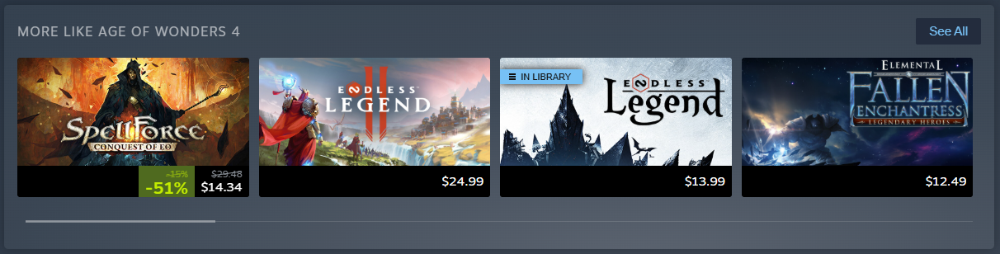
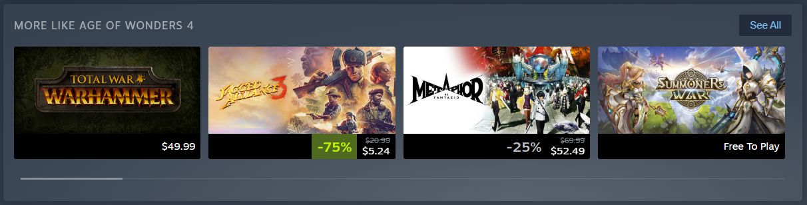
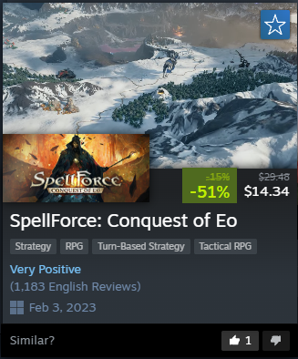
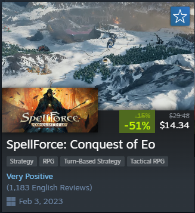

# Better Steam Recommendations

Steam's "More like this" row is supposed to show games similar to the one you're looking at. Open Age of Wonders 4,
a turn-based fantasy 4X game, and it suggests Total War: Warhammer, Jagged Alliance 3, Metaphor: ReFantazio and
Summoners War. The row is also shuffled on every visit, so the closest match can end up anywhere.

This extension replaces the games in that row with the "Games like" list from [SimilarGames.To](https://similargames.to),
which depends on user feedback.

✅ This

❌ instead of this

Steam still draws the row, so nothing looks out of place. Prices, discounts, the wishlist button, the "In library"
tag and the hover popup all work as before. Only the games change.

## Features

- Shows the first 20 games of the SimilarGames.To list, in the same order.
- Leaves out games from the same developer (Steam already shows them in the "More from" row above), unreleased games
  and delisted games.
- "See All" opens the full list on SimilarGames.To.
- A "Similar?" bar at the bottom of the hover popup lets you vote on each pick. Votes help clean up the lists.
  Clicking the same button again removes your vote.
- If a game isn't on SimilarGames.To, or its list doesn't arrive in time, Steam's own row is left alone.

| ✅ This | ❌ instead of this |
|---|---|
|  |  |

## Part of Better Steam Store

This extension is also included in [Better Steam Store](../store), which has all of our Steam
extensions in one.

## Privacy

The extension only connects to similargames.to. It sends the Steam app ID of the game page you open. A vote also
sends the app ID of the pick, your vote, and a random ID created when the extension is installed, so each install
counts once per pick. There's no account and no tracking, and nothing else is read from Steam.

## Install

Download or clone the [Better Steam Store repository](../..) first.

Chrome, Edge, Brave, Opera and other Chromium browsers:

1. Open `chrome://extensions` (`edge://extensions` in Edge) and turn on Developer mode.
2. Click "Load unpacked" and select the `extensions/recommendations` folder.

Firefox (140 or newer):

1. Open `about:debugging#/runtime/this-firefox`.
2. Click "Load Temporary Add-on" and select `manifest.json` in `extensions/recommendations`.

Firefox removes temporary add-ons when it restarts.

Thanks for reading. Contributions are welcome.
