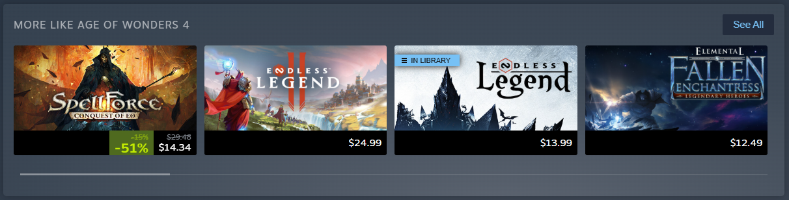
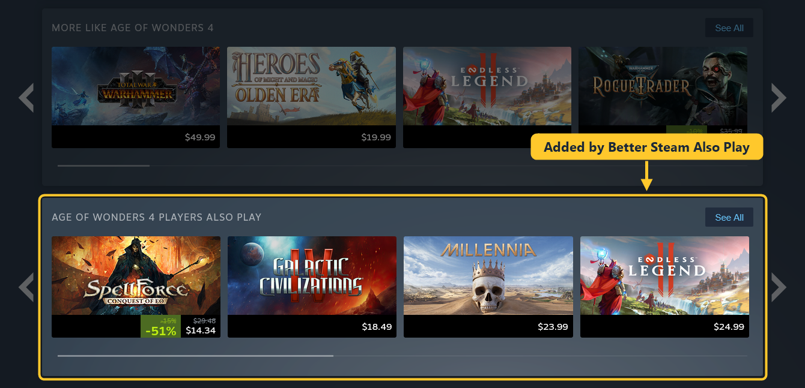
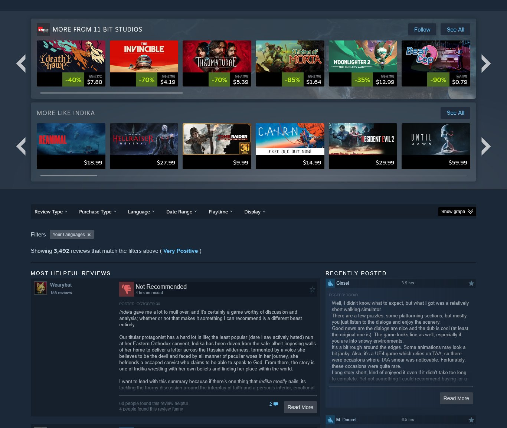
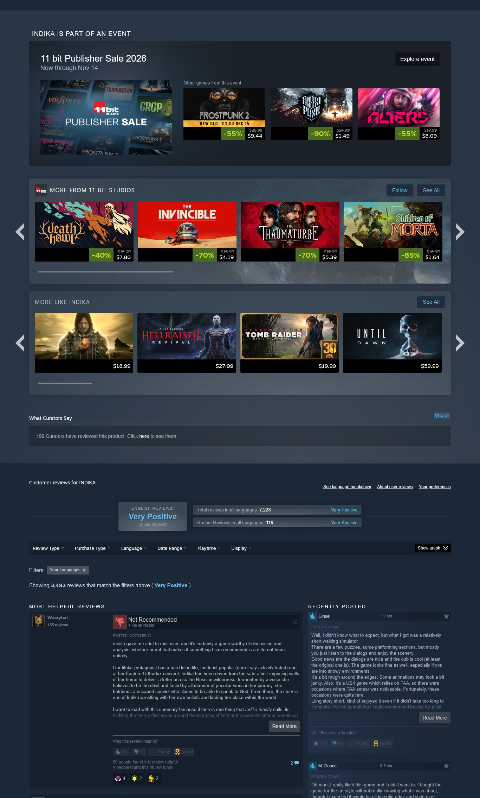

# Better Steam Store

All of our Steam extensions in one. Install this one and you get each of them, or pick only the parts you want as
standalone extensions.

## Better similar games

The "More like this" row shows the "Games like" list from [SimilarGames.To](https://similargames.to), which depends
on user feedback, in Steam's own design. A "Similar?" bar in each card's hover popup lets you vote on the picks.

Standalone: [Better Steam Recommendations](../recommendations)

## Players also play

A new row under "More like this" with the games the same players also play.

Standalone: [Better Steam Also Play](../also-play)

## Clean interface

Hide the parts of the store page you don't need and make the rows you keep smaller. Every change is a switch, under
the "Clean Interface" button next to "Community Hub".

✅ This

❌ instead of this

Standalone: [Better Steam Clean Interface](../clean-interface), where all the options are listed.

## Using it with the standalone extensions

There's no need to install the standalone extensions next to this one. If you do, each part only runs once, so
nothing shows up twice. Turning the standalone ones off keeps things simple.

## Privacy

The extension only connects to similargames.to. It sends the Steam app ID of the game page you open. A vote also
sends the app ID of the pick, your vote, and a random ID created when the extension is installed, so each install
counts once per pick. There's no account and no tracking, and nothing else is read from Steam. Clean interface
choices are saved in your browser's synced extension storage.

## Install

Better Steam Store is put together from the other extensions' folders, so it has to be built first. The ready-made
zip is attached to every [release](https://github.com/similargamesto/better-steam-store/releases).

To build it yourself, run `python scripts/build.py` in the repository. It creates `dist/store`.

Chrome, Edge, Brave, Opera and other Chromium browsers:

1. Open `chrome://extensions` (`edge://extensions` in Edge) and turn on Developer mode.
2. Click "Load unpacked" and select the `dist/store` folder.

Firefox (140 or newer):

1. Open `about:debugging#/runtime/this-firefox`.
2. Click "Load Temporary Add-on" and select `manifest.json` in `dist/store`.

Firefox removes temporary add-ons when it restarts.

Thanks for reading. Contributions are welcome.
